# Evaluation plan and current evidence

The evaluation is designed to separate synthetic verification from evidence
collected from real households. Synthetic results must never be reported as
real-world accuracy. The repository currently contains no labelled household
photos, real meter series, bills, recommendation feedback, or user-study
responses, so those sample sizes remain zero until permissioned data is added.

## Reproduce the current report

From the repository root, run:

```powershell
python scripts/evaluate.py
```

The script generates a clearly labelled 40-day synthetic demand sample,
performs time-ordered prediction and injected-anomaly checks, writes the
generated metric tables below, and creates SVG charts in `docs/figs/`. It uses
only the Python standard library and the existing demand/anomaly services.

Optional de-identified CSVs can be supplied to evaluate data that has been
collected with appropriate permission. Dates must use ISO `YYYY-MM-DD` form.

| Option | Required columns | Meaning |
|---|---|---|
| `--daily-csv` | `date,actual_kwh,predicted_kwh` | Real daily prediction, sorted chronologically; baselines use only prior actual values. |
| `--bills-csv` | `estimated_monthly_kwh,bill_units_kwh` | One row per home-month for sizing sanity. |
| `--detections-csv` | `true_type,predicted_type` | One labelled appliance item per row; optional `photo_id` supports reporting unique photos separately. |
| `--edits-csv` | `changed_items,total_items,seconds` | One row per completed appliance list. |
| `--sources-csv` | `source_tag` | One row per appliance item to report label/catalog/guess/user source shares. |
| `--anomaly-csv` | `actual_abnormal,predicted_high` | One real day per row; positive values may be yes/no, true/false, 1/0, or high/normal. |
| `--recommendations-csv` | `status,kwh_moved` | One recommendation feedback row; optional `date,rating` supports daily movement and usefulness summaries. |
| `--user-study-csv` | `usefulness,trust,days_observed` | One household response per row; optional `confusing,would_use` contains free-text and yes/no responses. |

Example:

```powershell
python scripts/evaluate.py --daily-csv data/eval/daily.csv --bills-csv data/eval/bills.csv
```

The script does not connect to Supabase or upload data. Keep personal
information out of evaluation CSVs and do not commit identifiable records.

## Metrics and protocol

| Area | Metric |
|---|---|
| Detection | Type accuracy and per-class precision/recall over labelled items; the target study is at least 100 labelled photos. |
| Edit effort | Changed items / all items, completion time per list, and source-tag share. |
| Sizing sanity | MAPE and percentage within 15% between estimated monthly kWh and bill units. |
| Demand | Daily MAE/MAPE compared with yesterday and the past-seven-day average; train chronologically on prior days only. |
| Anomaly | Precision/recall on injected synthetic abnormal days and, separately, agreement with user feedback on real days. |
| Recommendations | Share marked done, estimated kWh moved per day, and usefulness rating (1–5). |
| User study | 5–10 households for at least 7 days; usefulness and trust (1–5), confusing points, and intent to use before a purchase. |

MAPE omits zero-actual observations because percentage error is undefined
there; MAE still includes nonnegative observations. Baselines and model scores
must use the same evaluation dates. Do not randomly split time-series data.

## Honest limits

- The bundled demand evaluation is synthetic, deterministic test evidence only.
- Synthetic data is explicitly tagged and is never suitable for real-world
  accuracy claims.
- No real photos, labels, bills, meter readings, feedback, or user-study
  observations are bundled; all such results must state their sample sizes.
- Appliance catalog values are partly typical estimates, weather normals are
  approximate, forecast errors are not captured by the synthetic test, and
  there is no per-appliance metering.
- What-if results use one representative monthly climate-normal day per month;
  they are not an installer quotation or a guarantee of savings.

## Failure-case log

Do not invent failure cases or screenshots. Replace these pending rows with
observed cases, a screenshot captured with permission, and the change made in
response. Redact personal and location data before adding evidence.

| # | Observed failure | Screenshot | Change made |
|---|---|---|---|
| 1 | Pending real-user observation | Pending | Pending |
| 2 | Pending real-user observation | Pending | Pending |
| 3 | Pending real-user observation | Pending | Pending |
| 4 | Pending real-user observation | Pending | Pending |
| 5 | Pending real-user observation | Pending | Pending |

<!-- BEGIN GENERATED RESULTS -->
## Generated evaluation results

This section is refreshed by `python scripts/evaluate.py`. No real household or photo dataset is bundled.

### Daily energy prediction

| Dataset / method | MAE (kWh/day) | MAPE | Evaluated days |
|---|---:|---:|---:|
| Synthetic weather-aware model | 2.51 | 7.49% | 33 |
| Synthetic yesterday baseline | 3.83 | 11.82% | 33 |
| Synthetic past-7-day baseline | 3.75 | 12.07% | 33 |
| Optional real model | Not available | Not available | 0 |
| Optional real yesterday baseline | Not available | Not available | 0 |
| Optional real past-7-day baseline | Not available | Not available | 0 |

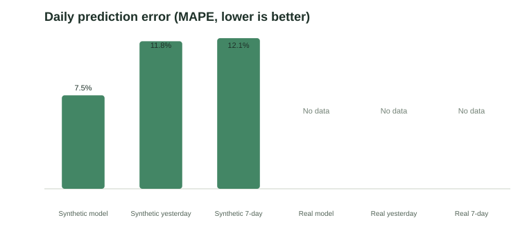

Evaluation is time-ordered. Synthetic model parameters are fit only on rows preceding each evaluated day; the real CSV is sorted by date and likewise uses only prior actual values for baselines.

### Anomaly detection

| Dataset | Precision | Recall | Evaluated days |
|---|---:|---:|---:|
| Injected synthetic abnormal days | 100.00% | 100.00% | 33 |
| Real user-feedback-labelled days | Not available | Not available | 0 |

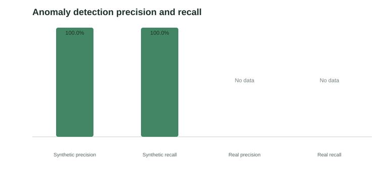

### Detection and sizing sanity

| Measure | Result | Sample |
|---|---:|---:|
| Real appliance type accuracy | Not available | 0 labelled items / 0 photos |
| Real bill MAPE | Not available | 0 home-months |
| Real estimates within 15% of bills | Not available | 0 home-months |
| User-edited appliance fields / items | Not available | 0 appliance items |
| Mean list completion time | Not available | 0 lists |

#### Per-class detection

| Appliance type | Precision | Recall | Labelled items |
|---|---:|---:|---:|
| No labelled classes supplied | Not available | Not available | 0 |

#### Source-tag coverage

| Source tag | Share | Items |
|---|---:|---:|
| No source-tag sample supplied | Not available | 0 |


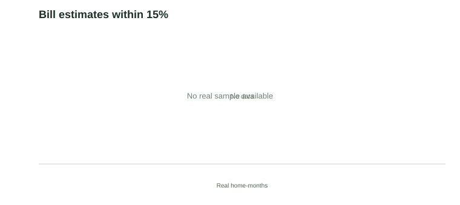

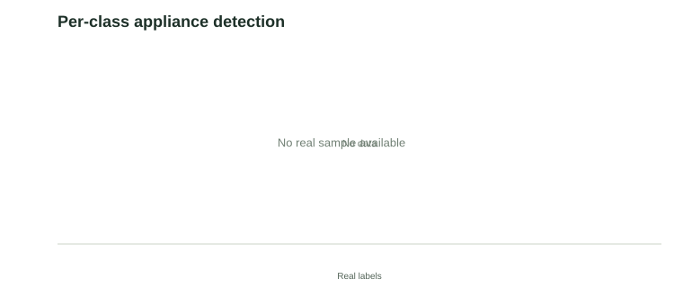

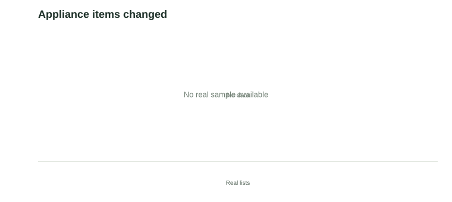

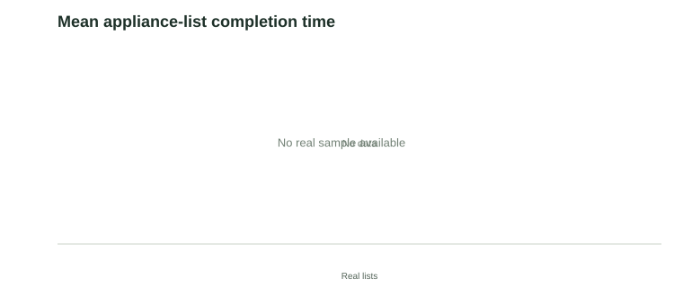

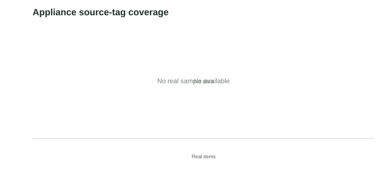

### Recommendations and user study

| Measure | Result | Sample |
|---|---:|---:|
| Recommendations marked done | Not available | 0 feedback rows |
| Estimated kWh moved per day | Not available | 0 days/feedback rows |
| Recommendation usefulness rating (1-5) | Not available | 0 ratings |
| User usefulness rating (1-5) | Not available | 0 households |
| User trust rating (1-5) | Not available | 0 households |
| Households with at least 7 observed days | 0 | 0 households |
| Households reporting something confusing | 0 | 0 households |
| Would use before buying solar | Not available | 0 responses |

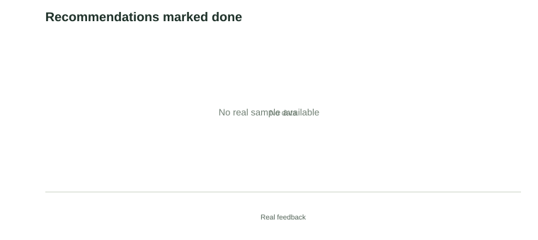

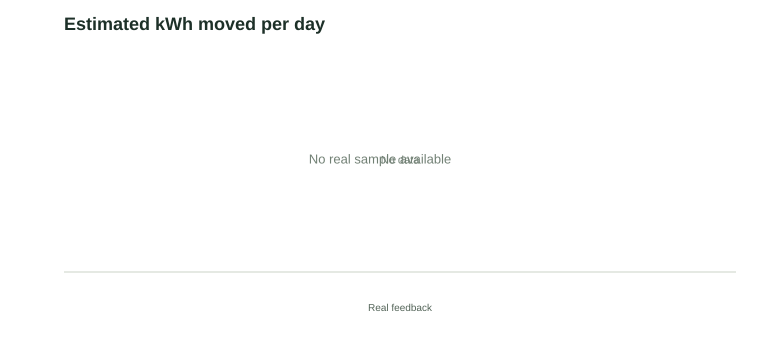

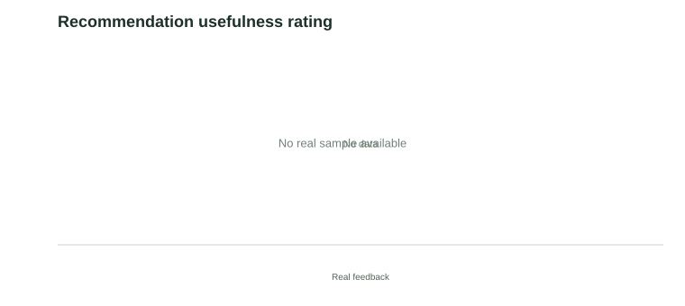

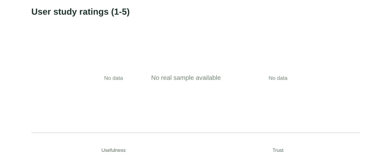


<!-- END GENERATED RESULTS -->
